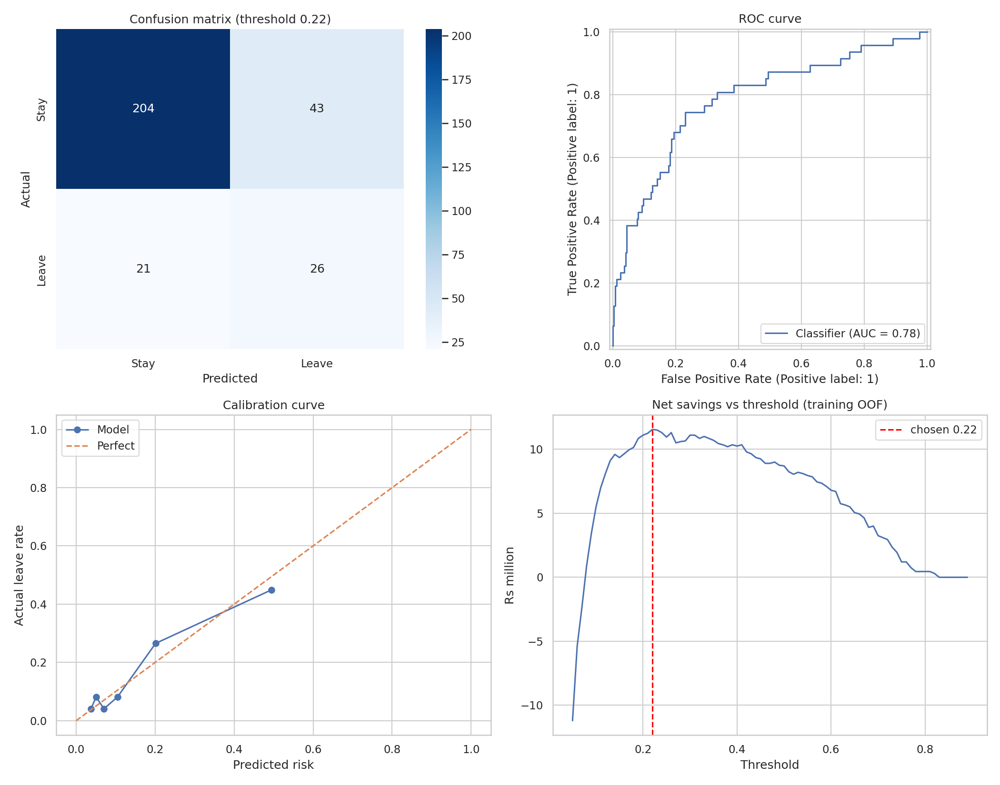
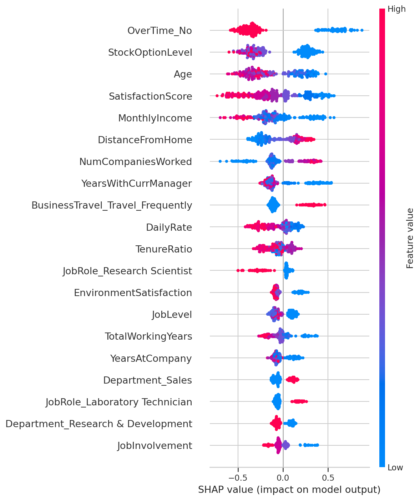

# Employee Attrition Prediction + Retention Simulator

An end-to-end machine learning project that predicts which employees are likely to leave, explains why, and tests which HR actions would reduce the risk most.

**Live demo:** [add your Hugging Face Space link here]
**Notebook:** [`Employee_Attrition_Prediction.ipynb`](Employee_Attrition_Prediction.ipynb) (runs in Google Colab)



## Problem

Replacing an employee is expensive, and HR usually finds out after the resignation. This project flags at-risk employees early and recommends what to do about it, using a decision threshold based on business cost instead of a generic accuracy metric.

## What makes this project different

| Feature | What it does |
|---|---|
| **Cost-based threshold** | The cut-off maximises estimated net savings using three editable assumptions: cost of replacing an employee, cost of one retention action, and intervention success rate. |
| **Calibrated probabilities** | A risk of 30% means roughly 30% of such employees actually leave (checked with a calibration curve). |
| **Retention What-If Simulator** | For any employee it re-scores the profile after actions such as removing overtime, a 15% raise or adding stock options, and ranks them by risk reduction. |
| **HR Action Report** | Top at-risk current employees with their main risk drivers and best action (`hr_action_report.csv`). |
| **Fairness audit** | Gender is excluded from the model; flag rate and recall are compared across gender and age groups. |
| **Explainability** | SHAP summary plot for global drivers and per-employee risk drivers in the app. |

## Dataset

[IBM HR Analytics Employee Attrition & Performance](https://www.kaggle.com/datasets/pavansubhasht/ibm-hr-analytics-attrition-dataset) (Kaggle): 1,470 employees, 35 columns, about 16% attrition. It is a **synthetic** dataset created by IBM data scientists. The CSV is not included in this repo; download it from Kaggle.

## Approach

1. **EDA:** class imbalance (about 84:16), attrition by overtime, role, marital status, travel and department.
2. **Feature engineering:** income per year of experience, tenure ratio, promotion gap, combined satisfaction score. Constant columns and `Gender` removed.
3. **Split before anything else:** stratified 80/20 train/test, so no information leaks from the test set.
4. **Model comparison (5-fold stratified CV):** logistic regression (class weights), logistic regression + SMOTE, random forest, XGBoost.
5. **Tuning:** randomized search on XGBoost, optimising ROC-AUC.
6. **Calibration and threshold:** sigmoid calibration, then the threshold is chosen on out-of-fold training predictions to maximise net savings. The test set is touched only once, for final evaluation.
7. **Explainability and fairness:** SHAP plot, per-group audit.
8. **Deployment:** Gradio app with the what-if simulator.

## Results (held-out test set)

Fill these in from your notebook output.

| Metric | Value |
|---|---|
| ROC-AUC | [X] |
| PR-AUC (baseline = attrition rate) | [X] |
| Brier score | [X] |
| Recall on "Leave" at the chosen threshold | [X] |
| Precision on "Leave" at the chosen threshold | [X] |
| Chosen threshold | [X] |
| Estimated net savings vs flagging everyone | Rs [X] vs Rs [Y] |

Cross-validation comparison of all models:

| Model | ROC-AUC | Recall | Precision |
|---|---|---|---|
| [paste `cv_table` here] | | | |

Accuracy is deliberately not the headline metric: predicting "stay" for everyone already scores about 84%.

## Key insights



- [Insight 1, for example: employees working overtime leave at roughly X times the rate of others]
- [Insight 2, for example: low income and no stock options increase risk]
- [Insight 3, for example: short tenure and single status are associated with higher attrition]
- [Recommendation for HR based on the What-If Simulator]

## Project structure

```
attrition-prediction/
├── Employee_Attrition_Prediction.ipynb   # full pipeline (Colab)
├── app.py                                # standalone Gradio app
├── attrition_model.pkl                   # calibrated model + app assets
├── requirements.txt                      # pinned versions
├── hr_action_report.csv                  # sample HR action report
├── evaluation.png                        # confusion matrix, ROC, calibration, savings
├── shap_summary.png                      # global feature importance
└── README.md
```

## How to run

**In Colab (recommended):** upload the notebook, choose Runtime -> Run all, and upload the Kaggle CSV when asked.

**The app locally:**

```bash
pip install -r requirements.txt gradio
python app.py
```

**Deploy on Hugging Face Spaces (free):**

1. Create a new Space, choose the Gradio SDK.
2. Upload `app.py`, `attrition_model.pkl`, `requirements.txt`.
3. Put this card at the top of the Space's own `README.md`, using the Gradio version printed by the notebook:

```yaml
---
title: Employee Attrition Predictor
emoji: 📉
sdk: gradio
sdk_version: X.Y.Z
app_file: app.py
---
```

## Limitations and responsible use

- The data is synthetic and small, so metrics are noisy and may not transfer to a real company.
- The cost figures are assumptions. A real HR team would supply their own.
- The What-If Simulator shows how the model's score changes, **not proven causal effects**. Use it to start a conversation, not to make decisions automatically.
- Age is a model input and is a protected attribute in many places. A production system would need legal review and a stricter fairness process.
- An attrition score should never be the sole basis for any employment decision.

## Future work

- Drift monitoring and periodic retraining on real data
- Survival analysis to predict *when* someone is likely to leave
- Causal methods (uplift modelling) for the what-if actions
- Experiment tracking with MLflow

## Tech stack

Python, pandas, NumPy, scikit-learn, imbalanced-learn, XGBoost, SHAP, Gradio, Google Colab
